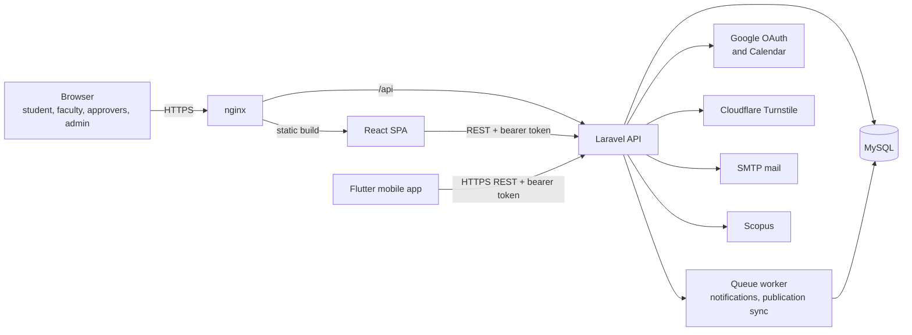
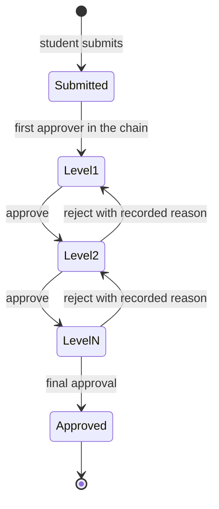
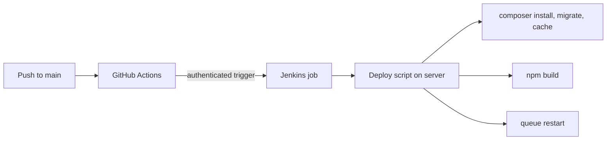

# Architecture

The portal is a layered web application: a React single-page client, a Laravel REST API, and a MySQL database. External services are reached through server-side helpers, so a provider can change without touching workflow code.

## System overview

- **Presentation layer.** The React client renders only what the signed-in role may see and sends every action to the server. It makes no authorization decisions, because a browser check can be bypassed by calling the API directly.
- **Application layer.** Laravel handles authentication, role-based access control, workflow enactment, validation, notifications and file handling. The API is stateless: the caller's role comes from the token on each request. The Flutter mobile app uses the same API, with no second server implementation. Its screens are drawn from page and form descriptions the server sends, so the web and mobile clients stay in step.
- **Data layer.** A relational store fits strongly related records, and a workflow transition has to commit atomically with its audit record.

## Workflow engine

Every form is a first-class record, not an uploaded file. It holds its type, field values, documents, current state and the ordered history of transitions.

- The approval chain for each form type is stored as an ordered list of roles. It is data, not routing code.
- Each action checks that the submission has reached that approver (separation of duty), applies the action, and records the actor, timestamp and reason.
- Rejection is just another transition. The reason travels with the form and shows to the stakeholder it returns to.
- Notifications are dispatched after the transition commits, so a mail failure cannot block or roll back an approval.

## Data model

The scholar is the centre of the model: supervisor allotment, doctoral committee, registered title, course work, publication links and the sequence of submissions made during candidature.

- Publications link to faculty and scholar records instead of being copied, so each is entered once.
- Departments, faculty, roles and capabilities are tables. Role menus and permissions are configuration.
- Project records link investigators, funding and recruitment to faculty profiles.

## Access control

Role-based access with a role hierarchy. A person holding more than one role switches roles rather than keeping duplicate accounts. Every record and document is authorized on the server. View-only roles see data but cannot act, except at the approval steps assigned to them.

## Security notes

- Cloudflare Turnstile guards sign-in and password reset.
- Google OAuth and institutional credentials for sign-in.
- Server-side authorization on every record and document.
- Uploads are stored outside the public web root and served through authorized endpoints.
- Secrets stay in environment configuration, never in the repository.

## Delivery

- The deploy script fails loudly if the code pull fails, so a broken pull never ships as a green build.
- The server pulls over a read-only deploy key.
- Schema changes are versioned migrations. Feature behaviour is covered by PHPUnit feature tests, and the client has Vitest tests.

## Testing

PHPUnit feature tests cover role gates, form approval chains, imports and department scoping. Vitest covers client logic. Demo and test accounts use fake data only.
